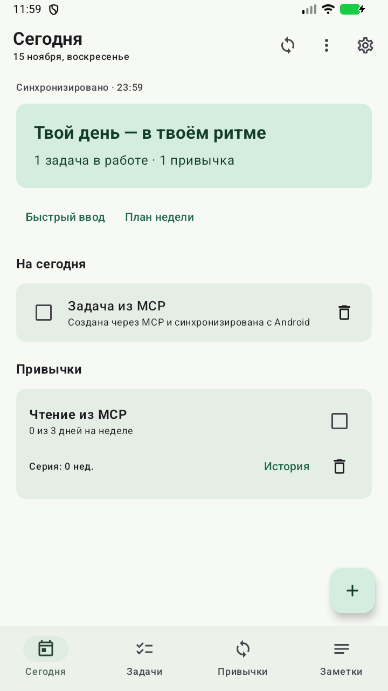

# Habit Tracker

Android-приложение на Kotlin и Jetpack Compose: задачи, заметки с файлами, привычки и управление через внешний AI-клиент по MCP.



## Возможности

- Экран «Сегодня», задачи со сроками и выполнением, поиск и редактирование заметок.
- Привычки по дням недели или цели N разных дней в неделю, история и серии.
- Изображения и файлы до 20 МБ; открытие установленными приложениями.
- Room и постоянная очередь изменений: создание и редактирование без сети, синхронизация через WorkManager.
- Пока приложение открыто, сервер проверяется каждые 10 секунд и при возвращении на экран; в фоне — периодическая работа WorkManager.
- Сохранение двух версий при конфликте и явный выбор пользователя.
- Локальные напоминания о задачах и привычках, перепланирование после перезапуска устройства и изменения времени.
- Аккаунты по email и паролю, отдельные данные пользователей, OAuth/PKCE для AI, обновление и отзыв токенов.
- MCP: чтение, создание, редактирование, выполнение и удаление записей; отдельный запрос содержимого вложения.
- Быстрый ввод русской даты, план недели, проекты, цели, теги, связи и общий поиск.
- Виджет «Сегодня», действия из уведомлений, тихие часы и ежедневная сводка.
- Статистика привычек за 7/30 дней, приём текста и файлов через «Поделиться», ZIP-копии с восстановлением.
- Разбор недели через внешний AI-клиент и предложения плана, применяемые после подтверждения в Android.

[Возможности версии 0.4 и сценарии проверки](docs/FEATURES_0_4.md). Перед использованием проектов и AI-планов обнови все Android-клиенты до 0.4: версия 0.3 не понимает новые типы записей.

Email + пароль работают без отправки писем. Добавлены OAuth-вход через Google, VK и Яндекс и явная привязка способов входа в настройках. До регистрации приложений у провайдеров и локальной настройки ключей соответствующие кнопки отключены. [Настройка и статус проверки соцвхода](docs/SOCIAL_AUTH.md). Подтверждение почты и восстановление пароля пока не реализованы.

## Быстрый запуск на Windows

Нужны JDK 21, PowerShell 7, Android SDK 36.1 / Build Tools 36.0.0 и интернет для первой загрузки зависимостей. В `local.properties` укажи свой `sdk.dir` или установи `ANDROID_HOME`.

```powershell
# Основной backend и постоянный локальный PostgreSQL, без Docker:
.\scripts\Start-Backend.ps1
```

Скрипт создаёт случайные секреты в `.local/backend.env`; они исключены из Git. API работает на порту **8081**, PostgreSQL — только на loopback:5433. Локальный launcher включает парольную авторизацию PostgreSQL и постоянное хранение `.local/postgres`; файлы находятся в `.local/backend-files`. Остановка: `./scripts/Stop-Backend.ps1`.

Альтернатива с Docker:

```powershell
.\scripts\Start-Backend.ps1 -Docker
# Остановка контейнеров без удаления данных:
docker compose --env-file .local/backend.env down
```

Данные Docker сохраняются в volumes. Docker-вариант не прошёл локальную проверку: установленный Docker Desktop завершается при запуске; локальный PostgreSQL-вариант проверяется отдельно и не зависит от него.

В другом терминале:

```powershell
.\gradlew.bat :android-app:assembleDebug
```

APK: `android-app/build/outputs/apk/debug/android-app-debug.apk`. При пути проекта с кириллицей на Windows build-артефакты автоматически направляются в `%TEMP%/habit-tracker-<id>/<module>`; готовый APK также выдаётся в GitHub Releases и артефактах CI. SDK-путь, кеши и локальные данные в Git не попадают.

В приложении зарегистрируй аккаунт. Для Android Emulator адрес сервера — `http://10.0.2.2:8081`. Для телефона в одной сети используй IP компьютера и порт 8081; доступность порта зависит от локальной сети. HTTP разрешён только в debug-сборке, release требует HTTPS. Для первого входа нужна сеть; после входа записи доступны локально. Вложения доступны офлайн после сохранения или первого открытия.

## Подключение AI в локальном приложении ChatGPT / Codex

Для распространения среди пользователей см. [публичный плагин для ChatGPT](docs/CHATGPT_PLUGIN.md).

Основной сервер **не использует** отдельное тестовое хранилище `mcp-probe`: REST и MCP читают одну PostgreSQL-базу и один аккаунт.

```powershell
# Подключить собственный аккаунт: email и пароль вводятся локально, пароль скрыт.
.\scripts\Connect-Desktop.ps1 -Backend
# Если habit-tracker уже добавлен:
.\scripts\Connect-Desktop.ps1 -Backend -UpdateExisting
# Отдельный демонстрационный аккаунт для проверки:
.\scripts\Connect-Desktop.ps1 -Backend -DemoAccount -UpdateExisting
# Проверить OAuth и каталог всех инструментов через настоящий клиент:
.\scripts\Test-Desktop.ps1 -ExpectedToolCount 17
```

Конфигурация сохраняется в `~/.codex/config.toml`, предыдущая копия — в `.local/backups`. Статический секрет OAuth-клиента хранится в приватном локальном конфиге, access/refresh-токены — средствами клиента. Скрипт не выводит их и не передаёт секреты в командной строке. Изменения состава MCP иногда требуют нового чата или полного перезапуска приложения.

URL: `http://127.0.0.1:8081/mcp`, callback: `http://127.0.0.1:45838/callback`. Политика `writes` оставляет подтверждения операций записи включёнными. Access token действует час, refresh token — до 30 дней с ротацией; отзыв access token отзывает связанный refresh token.

| Инструмент | Назначение |
| --- | --- |
| `get_tasks`, `get_notes`, `get_habits`, `get_habit_history` | Актуальные данные аккаунта |
| `create_task`, `create_note`, `create_habit` | Создание без дубликатов при повторе operation_id |
| `update_item` | Изменение с expected_version |
| `complete_task`, `mark_habit` | Выполнение задачи или отметка привычки |
| `delete_item` | Удаление выбранной записи с подтверждением |
| `get_attachment` | Содержимое конкретного вложения только по отдельной просьбе, до 5 МБ |
| `get_projects`, `create_project`, `search_records` | Проекты/цели и поиск по записям |
| `get_week_review`, `propose_week_plan` | Факты за неделю и предложение переносов без изменения дат |

Примеры: «Создай задачу прочитать главу до пятницы», «Хочу бегать по вторникам и четвергам», «Что осталось сделать?». Если дата или расписание неоднозначны, ассистент должен уточнить их. После изменений в Android ассистент при следующем чтении получает обновлённое состояние; фоновых сообщений в чат нет.

MCP не гарантирует одинаковые подтверждения и совместимость всех AI-клиентов. Проверка с Алисой не проводилась. Передача файла возвращает метаданные и стандартный MCP image/resource; интерпретация формата зависит от клиента.

## Интернет-демонстрация

```powershell
.\scripts\Start-Internet.ps1
# Запускает backend, если он выключен, и проверяет HTTPS-туннель.
# Показанный HTTPS URL используй как адрес сервера на любом телефоне.
.\scripts\Test-Internet.ps1
# Проверяет вход, создание, синхронизацию и удаление с синтетическим аккаунтом.
.\scripts\Stop-BackendTunnel.ps1
```

USB для интернет-подключения не нужен. Установи APK и войди или зарегистрируйся: физический телефон сам получает адрес нашего сервера. Если нужен собственный сервер, открой дополнительные настройки на экране входа или **Настройки → Подключение к серверу**. Ручная смена адреса с повторным входом в тот же аккаунт сохраняет Room-базу, очередь офлайн-операций и файлы; подключение к чужому аккаунту этим способом отклоняется.

В версии 0.3 физические телефоны по умолчанию **подключаются автоматически**. `Start-Internet.ps1` публикует только HTTPS-адрес в отдельной ветке `connection` этого репозитория; фоновый наблюдатель отслеживает смену адреса и восстанавливает оборванный SSH-туннель. Приложение читает указатель и проверяет подпись ECDSA со свежим nonce перед отправкой пароля или сессии. Открытый ключ встроен в APK; закрытый остаётся в постоянном файловом хранилище backend. Перенос адреса сохраняет ту же Room-базу и офлайн-очередь. GitHub-учётные данные нужны только компьютеру для публикации адреса, на телефоны они не передаются. Остановка туннеля также останавливает наблюдатель.

Для своей копии проекта нужны собственная ветка адреса, закрытый ключ сервера и APK с соответствующим открытым ключом (`config/server-public-key.txt` и `android-app/src/main/res/raw/server_public_key.txt`). Не удаляй каталог `.connection-identity` из постоянного файлового хранилища. В эмуляторе автоматическое подключение отключено по умолчанию, чтобы локальные тесты не зависели от интернета. Ручной адрес остаётся в дополнительных настройках.

На экране отображается результат последней синхронизации и число ожидающих отправки изменений. Пока приложение открыто, проверка происходит каждые 10 секунд; в фоне WorkManager запускает периодические проверки с ограничениями Android. Компьютер должен быть включён и не находиться в спящем режиме. После перезапуска компьютера снова выполни `Start-Internet.ps1`; бесплатный туннель не гарантирует постоянство адреса или непрерывную доступность.

Используется бесплатный localhost.run без передачи пользовательских SSH-ключей. Провайдер завершает HTTPS и может видеть передаваемые данные; временный домен может смениться. Это демонстрационный доступ, а не постоянный хостинг. Скрипт не меняет локальный OAuth issuer. Для удалённого MCP-клиента потребуется публичный `PUBLIC_URL`, соответствующий callback allowlist и повторное подключение.

## Проверки

```powershell
.\gradlew.bat :shared:test :backend:test :mcp-probe:test :android-app:lintDebug :android-app:assembleDebug
# После запуска backend и Android-эмулятора:
.\gradlew.bat :android-app:connectedDebugAndroidTest
```

JVM-тесты используют настоящий PostgreSQL 17.6 из тестовой библиотеки, Docker им не нужен. Покрыты правила привычек, сериализация, пароли/сессии, изоляция аккаунтов, ротация OAuth, повторные операции, конкурентные правки, tombstones, HTTP OAuth/MCP и доступ к файлам.

Android-тесты проверяют сохранение после пересоздания репозитория/экрана, конфликт телефона и сервера, выбор версии, файлы, смену аккаунта и Compose-сценарий создания задачи. Дополнительный общий сценарий создаёт задачу, заметку и привычку через MCP, затем получает их в Android:

```powershell
# Только отдельный демо-аккаунт, созданный Connect-Desktop -Backend -DemoAccount:
.\scripts\Test-SharedAccount.ps1
```

Для проверок новых возможностей можно запустить полностью отдельную одноразовую базу и backend, доступный только на loopback, без чтения `.local/backend.env`:

```powershell
# Оставить работающим в отдельном терминале, остановить Ctrl+C:
.\gradlew.bat :backend:runFeatureTests
# В другом терминале, при запущенном эмуляторе:
.\scripts\Test-Features.ps1 -BaseUrl http://127.0.0.1:18082
.\gradlew.bat :android-app:connectedDebugAndroidTest '-Pandroid.testInstrumentationRunnerArguments.backend_url=http://10.0.2.2:18082' '-Pandroid.testInstrumentationRunnerArguments.class=dev.habittracker.android.IntegrationTest,dev.habittracker.android.FeatureIntegrationTest'
.\scripts\Test-SharedAccount.ps1 -Synthetic -BaseUrl http://127.0.0.1:18082 -AndroidBaseUrl http://10.0.2.2:18082
```

По умолчанию Android-тесты используют `10.0.2.2:8081`. Для установленного API 37 эмулятора в тестовом APK используется совместимая версия Espresso 3.8 alpha; в пользовательский APK она не включается. Основные функции и Google-привязка проверены на физическом телефоне в 0.3; новые сценарии 0.4 проверяются на эмуляторе. Длительная работа фоновых уведомлений на разных устройствах не проверена. Уведомления могут задерживаться ограничениями Android.

CI выполняет JVM-тесты, Android lint и сборку APK. Исходный `mcp-probe` оставлен как изолированная проверка протокола и не используется основной функциональностью.

## Структура

- `shared` — модели, валидация, расчёт привычек и протокол синхронизации.
- `backend` — Ktor, PostgreSQL/Flyway, аккаунты, REST, OAuth и MCP.
- `android-app` — Compose, ViewModel/StateFlow, Room, WorkManager, вложения и напоминания.
- `mcp-probe` — первоначальный изолированный прототип MCP.
- [Архитектура и HTTP API](docs/ARCHITECTURE.md).

Проект предназначен для учебной демонстрации. Перед длительным публичным использованием нужны стабильный HTTPS-хостинг, резервное копирование, сборка неиспользуемых файлов, распределённое ограничение запросов и отдельная проверка безопасности.
