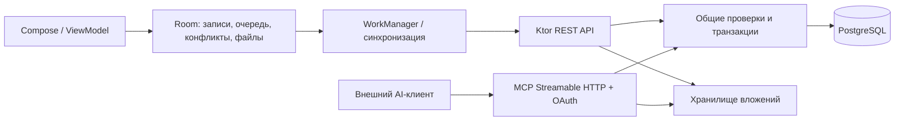

# Архитектура



## Данные и границы

`shared` содержит сериализуемые контракты задач, заметок, привычек и отметок выполнения. `Item` — конверт с UUID, версией, признаком удаления, серверным временем и последовательностью изменений. Тип содержимого сохраняется в поле `kind`; менять его у существующей записи нельзя.

Версия 0.4 добавляет `project` (проект или цель) и `week_plan` (предложение AI). `Organization` у задач, заметок и привычек содержит проект, цель, теги и связи. Backend проверяет принадлежность всех ссылок тому же аккаунту. `completedAt` фиксирует завершение задачи; импортированные старые выполненные задачи без даты не приписываются текущей неделе. Перед использованием новых типов нужны Android-клиенты 0.4.

Задача хранит название, описание, необязательные локальные дату/время, часовой пояс, время напоминания и состояние выполнения. Заметка — название, текст и UUID вложений. Привычка задаётся днями недели либо целью N разных дней календарной недели. Отметка имеет детерминированный UUID от привычки и даты, поэтому двойной клик не создаёт две отметки за день.

Неделя начинается в понедельник. Серия для расписания считается по запланированным дням; сегодняшний ещё не отмеченный день не обрывает её заранее. Для недельной цели серия считается по выполненным неделям; текущая неделя может оставаться открытой. Даты отметок до начала привычки, в будущем и вне расписания сервер отклоняет.

## Синхронизация

1. Изменение сразу записывается в Room вместе с операцией в outbox. Интерфейс читает Room, сеть не блокирует редактирование.
2. Операция содержит `operationId`, UUID записи и `baseVersion`. Backend блокирует строку пользователя, проверяет журнал операций и сравнивает версию.
3. Повтор идентичной операции возвращает сохранённый ответ; повтор UUID операции с другим содержимым отклоняется. Успешная запись увеличивает версию и счётчик пользователя в одной транзакции.
4. При несовпадении версии сервер возвращает актуальную запись. Room сохраняет обе версии, а интерфейс предлагает выбор; автоматического перезаписывания нет.
5. Если запись редактировалась во время запроса, подтверждение старой операции не удаляет новую. Новая операция перебазируется на подтверждённую серверную версию.
6. Серверные изменения читаются страницами по курсору. Удалённые записи остаются tombstone; cursor продвигается только после транзакции Room.

Новые проекты отправляются до зависимых записей. Для взаимных офлайн-связей сначала создаются записи без `linkedIds` с отдельным детерминированным operationId, затем исходная операция восстанавливает связи. Пакет ограничен 100 операциями и примерно 7 МиБ JSON; HTTP-лимит 8 МиБ. После 20 раундов оставшаяся очередь передаётся следующему запуску WorkManager.

AI сохраняет предложение с версиями исходных задач, не меняя их. Применение через отдельный маршрут под блокировкой пользователя проверяет все версии и переносит задачи одной транзакцией. Устаревшая задача отклоняет весь план; повторное применение не переносит повторно. Обычная mutation не может пометить план применённым.

Данные и outbox разделены по аккаунту и серверу. Перед каждым сетевым запросом проверяется, что текущий аккаунт совпадает с владельцем репозитория. Это предотвращает отправку данных предыдущего аккаунта с токеном нового.

Вложения копируются в приватное хранилище телефона, затем загружаются отдельно после синхронизации заметки. Содержимое файла неизменно для его UUID, размер ограничен 20 МБ. Удаление ссылки из заметки сразу прекращает доступ к файлу через API. Фоновая очистка блокирует изменения аккаунта на время проверки, удаляет устаревшую метаинформацию и ставит байты в устойчивую очередь удаления. Ошибка файловой системы оставляет задание в очереди для повторной попытки; вложения других аккаунтов не затрагиваются.

## Авторизация

По согласованию первая версия использует email и пароль без отправки писем. Пароли — PBKDF2-HMAC-SHA256, 600 000 итераций, случайная соль. В базе хранятся хеши непрозрачных токенов; Android шифрует сессию AES-GCM с ключом Android Keystore. Пароль не сохраняется на телефоне.

Сессия Android действует 30 дней. Смена существующего пароля требует текущий пароль; впервые задать пароль в аккаунте соцвхода можно только в течение 10 минут после повторной авторизации. В обоих случаях другие Android-сессии и доступ ChatGPT отзываются. OAuth для MCP — authorization code с PKCE S256, точные callback URI, issuer/resource binding, права чтения/записи. Access token действует час; refresh token — до 30 дней и меняется при каждом использовании. Отзыв access token отзывает связанный refresh token. Вход, согласие OAuth и начало подключения ограничены 20 запросами в минуту на IP на каждом экземпляре. За reverse proxy заголовок IP включается только явной настройкой `TRUSTED_CLIENT_IP_HEADER`: `X-Real-IP` для Caddy, `CF-Connecting-IP` для Cloudflare или `X-Envoy-External-Address` для Northflank.

MCP-аннотации и политика `writes` включают подтверждения записи в клиенте. Подтверждение удаления дополнительно явно требуется описанием инструмента. Сервер не принимает фиктивное `confirmed=true` как доказательство согласия пользователя. Нативный интерфейс конкретного AI-клиента необходимо проверить отдельно; MCP не гарантирует одинаковое поведение всех клиентов.

## HTTP API

| Метод и путь | Назначение |
| --- | --- |
| POST `/api/v1/auth/register`, `/auth/login` | Регистрация/вход; JSON `email`, `password` |
| POST `/api/v1/logout` | Отозвать текущую сессию |
| POST `/api/v1/account/revoke-sessions` | Отозвать все сессии и связанные refresh-токены |
| POST `/api/v1/account/password` | Сменить пароль по текущему; завершить остальные сессии и MCP-доступ |
| GET `/api/v1/items`, `/items/{id}` | Записи текущего аккаунта |
| POST `/api/v1/mutations` | Одна операция с проверкой версии |
| POST `/api/v1/sync` | Отправить outbox и получить страницу изменений |
| POST `/api/v1/week-plans/{id}/apply` | Явно применить предложение целиком; JSON `expectedVersion` |
| GET `/api/v1/notes/{id}/attachments` | Метаданные вложений |
| PUT, GET `/api/v1/attachments/{id}` | Передать/получить байты конкретного файла |
| POST `/mcp` | MCP Streamable HTTP |

Пример создания задачи:

```json
{"operationId":"55359e99-622f-4fe2-b410-25d5b03151c7","itemId":"6439d4b6-06ac-4e76-b88b-85fb41e265aa","baseVersion":0,"content":{"kind":"task","title":"Прочитать главу"},"deleted":false}
```

Напоминания — локальный AlarmManager; точность может ограничиваться Android, режимом энергосбережжения и разрешением уведомлений. Перезапуск устройства, смена часового пояса и изменения записей перепланируют напоминания.

Виджет RemoteViews читает ту же Room-базу. Действия виджета и уведомлений привязаны к userId; отложенное действие предыдущего аккаунта не меняет данные нового. Тихие часы с переходом через полночь сдвигают время, сводка может заменить отдельные напоминания.

Входящие Share-файлы копируются в приватную очередь до истечения разрешения на исходный URI. Только подтверждение создаёт запись. ZIP-копия содержит активные записи, файлы и обе версии конфликтов, без сессий и ключей. Импорт проверяет структуру и размеры до записи и создаёт копии с UUID, детерминированными по аккаунту и SHA-256 архива. Старые AI-планы и конфликтные версии восстанавливаются заметками; архив не выполняет команды и не перезаписывает текущие записи.
