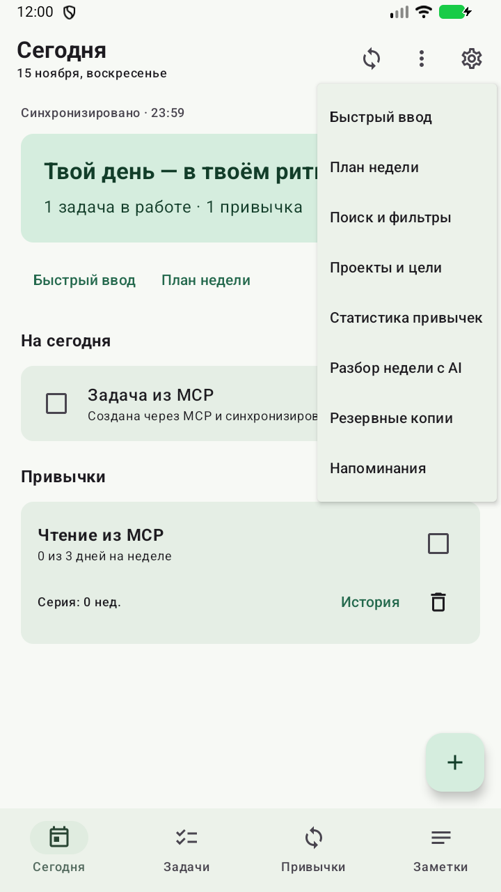

# Habit Tracker 0.4

Десять направлений доступны в приложении. Дополнительные экраны открываются кнопкой «Возможности» справа сверху; быстрый ввод и неделя также доступны на экране «Сегодня».

| Возможность | Как пользоваться |
| --- | --- |
| Быстрый ввод | «Сдать отчёт завтра в 18:00» → распознать → проверить дату → открыть редактор и сохранить. Поддержаны сегодня/завтра/послезавтра, ближайший день недели, дата Д.М.ГГГГ и время. Неоднозначные фразы требуют проверки. |
| Виджет | Добавить Habit Tracker через меню виджетов домашнего экрана. Задачи на сегодня/без срока и привычки, максимум пять строк с учётом размера. ✓ сохраняет выполнение локально и запускает синхронизацию. Есть обновление и быстрый ввод. |
| План недели | Листать недели, открыть задачу или нажать «Перенести» и выбрать день. Задачи без срока можно запланировать. Перенос сохраняет время задачи. |
| Статистика | Периоды 7/30 дней, календарь отметок и сравнение с предыдущим равным периодом. Расписание и недельная цель учитываются отдельно, до начала привычки дни не учитываются. |
| Разбор с AI | Скопировать запрос из экрана разбора в подключённый MCP-клиент того же аккаунта. AI читает `get_week_review` и сохраняет `propose_week_plan`. Предложение появится после синхронизации; даты меняются после просмотра и подтверждения в Android. |
| Цели и связи | Создать проект/цель. В редакторе записи выбрать проект, цель, теги и связанные записи. У цели виден прогресс связанных задач, по связи можно открыть запись. |
| Поделиться | В другом приложении выбрать текст, ссылку или файлы → Habit Tracker. Проверить черновик и создать заметку; текст без файлов можно сохранить задачей. До подтверждения записи нет. |
| Напоминания | В уведомлении: «Выполнено», «Через час», «Завтра». В настройках — тихие часы, ежедневная сводка и режим только сводки. |
| Резервная копия | Экспортировать ZIP через системный выбор файла. При импорте показан состав; восстановление создаёт копии. Повтор того же файла в том же аккаунте не создаёт дубликаты. |
| Поиск | Название, текст и теги по всем записям; фильтры типа, проекта/цели и тега. |

## Поведение и ограничения

- Все текстовые изменения сохраняются в Room и переживают отсутствие сети. Взаимные ссылки и очереди больше 100 операций отправляются несколькими пакетами. SQLite-драйвер включён в APK для больших заметок без ограничения Android CursorWindow; формат существующей базы сохраняется. [Документация Room о драйверах](https://developer.android.com/training/data-storage/room/migration-2-to-3).
- Разбор выполняет внешний AI-клиент через MCP; приложение не покупает API-вызовы. Предложение не выполняет переносы самостоятельно. Изменившаяся задача отклоняет весь план без частичного применения.
- Share принимает до 30 файлов по 20 МиБ. Приватная очередь ограничена 10 черновиками и 512 МиБ; файлы копируются до истечения разрешения источника.
- Копия не зашифрована. В неё входят активные записи, вложения и обе версии конфликтов; пароли, токены и ключи не входят. Недоступное вложение останавливает экспорт с ошибкой вместо неполной копии.
- Импорт: архив до 1 ГиБ, manifest до 32 МиБ, до 10 000 записей и 10 000 файлов, файл до 20 МиБ. Неизвестные пути, дубли и неполный состав отклоняются до создания записей. Версии конфликтов и старые AI-планы восстанавливаются заметками. Текущие записи не перезаписываются.
- Android может задерживать уведомления и фоновые задачи. Виджет нужно добавить на домашний экран вручную; размер ограничивает число строк.
- Дата завершения ранее выполненных задач может быть неизвестна. Они не включаются в недельный итог завершений.
- Перед использованием новых проектов/планов обновить все Android-клиенты до 0.4: 0.3 не поддерживает новые типы. Новая SQL-миграция не требуется; прежние JSON-записи и аккаунты сохраняются.
- Каталог MCP увеличен с 12 до 17 инструментов; клиенту может потребоваться обновление каталога или перезапуск.

## Проверка

Изолированный запуск описан в [README](../README.md#проверки). Тестовый backend слушает только `127.0.0.1:18082`, создаёт одноразовую PostgreSQL-базу и не загружает рабочие ключи соцвхода.

Автоматические сценарии покрывают быстрый ввод и перенос в Compose, проект и поиск, отмену/применение AI-плана, импорт с файлами и повторный импорт, опасный ZIP, Share после исчезновения исходного файла, действия уведомлений и виджета, взаимные офлайн-ссылки в очереди из 107 записей, большие Unicode-заметки, совместимость старой Room-базы. JVM-проверки покрывают расписания, недельные цели, часовые пояса, тихие часы, изоляцию ссылок, версии и атомарность переноса. Отдельный MCP-сценарий проверяет факты, поиск, предложение без изменений и явное применение.

Длительная работа уведомлений на разных устройствах и виджет в разных лаунчерах требуют дополнительной проверки на устройствах. Google и Яндекс сохраняют настроенные интеграции. VK остаётся незавершённым пунктом: доступ к кабинету заблокирован проверкой безопасности браузера.

Результат локальной проверки выпуска: 43 JVM-теста; 12 Android-сценариев (после исправления прокрутки планировщик повторно пройден отдельно) и дополнительный сквозной MCP → Android; MCP-smoke, Android lint и обе сборки APK прошли. Все новые интеграционные проверки использовали одноразовые аккаунты и отдельную базу на loopback. Обновление действующего публичного backend выполняется отдельно после разрешения на развёртывание.
